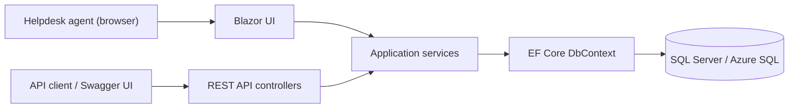
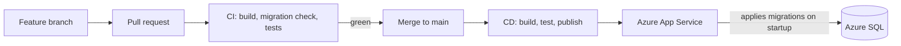

# MDK IT Helpdesk

A small internal tool for an IT helpdesk team to manage support tickets. Built with **C# / .NET 10**, **ASP.NET Core** (REST API + Blazor UI), **Entity Framework Core** and **SQL Server**, and deployed to **Azure App Service** with **Azure SQL**.

| | |
|---|---|
| **Live site** | https://mdk-it-helpdesk-kiran-htafg9b0hwc5cqa4.westus3-01.azurewebsites.net |
| **API docs (Swagger)** | https://mdk-it-helpdesk-kiran-htafg9b0hwc5cqa4.westus3-01.azurewebsites.net/swagger |
| **Health check** | https://mdk-it-helpdesk-kiran-htafg9b0hwc5cqa4.westus3-01.azurewebsites.net/health |

> The live site runs on free and serverless Azure tiers that sleep when idle. The first request after a quiet period can take up to a minute while the app and the database wake up; after that it responds normally.

## Features

- Create, view, update and list tickets
- Assign a ticket to a user, or unassign it
- Filter tickets by status and/or assigned user, including unassigned tickets
- Creation and update timestamps tracked automatically, in UTC
- The same operations exposed as a REST API, documented with Swagger

## Run it locally

**Prerequisites:** [Git](https://git-scm.com/downloads), the [.NET 10 SDK](https://dotnet.microsoft.com/download) and SQL Server LocalDB (installed with Visual Studio's *ASP.NET and web development* workload). The full guide, including Visual Studio, Docker and troubleshooting, is in [docs/SETUP.md](docs/SETUP.md).

```bash
# 1. Get the code
git clone https://github.com/bujji1/mdk-it-helpdesk.git
cd mdk-it-helpdesk

# 2. Restore packages and install the EF Core CLI (once)
dotnet restore
dotnet tool install --global dotnet-ef --version 10.0.15

# 3. Create the database and seed data (4 users, 4 tickets)
dotnet ef database update --project src/MdkHelpdesk.Infrastructure --startup-project src/MdkHelpdesk.Web

# 4. Run the app
dotnet run --project src/MdkHelpdesk.Web --launch-profile https

# 5. Run the tests (no database needed)
dotnet test
```

Then open https://localhost:7104 for the UI and https://localhost:7104/swagger for the API docs.

Not on Windows, or no LocalDB? Run SQL Server in Docker instead; see [docs/SETUP.md](docs/SETUP.md#using-docker-instead-of-localdb).

## Architecture



| Project | Responsibility | Depends on |
|---|---|---|
| `MdkHelpdesk.Domain` | Entities (`User`, `Ticket`) and the `TicketStatus` enum | nothing |
| `MdkHelpdesk.Application` | Business logic (`TicketService`, `UserService`), request/response DTOs, validation rules | Domain |
| `MdkHelpdesk.Infrastructure` | EF Core `AppDbContext`, table mapping, migrations, seed data | Application, Domain |
| `MdkHelpdesk.Web` | REST controllers, Blazor pages, error handling, dependency-injection wiring | all of the above |

The Blazor pages and the REST controllers both call the same application services, so business rules live in exactly one place.

## REST API

| Method | Path | Purpose | Responses |
|---|---|---|---|
| GET | `/api/tickets?status=&assignedUserId=&unassigned=` | List tickets, optionally filtered by status and by assignee (or unassigned only) | 200, 400 |
| GET | `/api/tickets/{id}` | Get one ticket | 200, 404 |
| POST | `/api/tickets` | Create a ticket (starts as Open) | 201, 400 |
| PUT | `/api/tickets/{id}` | Update title, description and status | 200, 400, 404 |
| PATCH | `/api/tickets/{id}/assign` | Assign to a user, or unassign with `null` | 200, 400, 404 |
| GET | `/api/users` | List users available for assignment | 200 |
| GET | `/health` | Health check, including database connectivity | 200, 503 |

Errors are returned as RFC 7807 `ProblemDetails`. Status values are `Open`, `InProgress` and `Closed`.

## Tech and design choices

- **Blazor Server for the UI, plus REST controllers.** Blazor keeps the whole stack in C# and lets pages call the application services directly, which suits a small internal tool. The REST API is there for integrations and is what the integration tests exercise.
- **Layered projects with dependencies pointing inward.** The domain has no dependencies; business logic reaches the database through the `IAppDbContext` interface, so it does not depend on the concrete EF Core context. I stopped short of adding a repository layer: EF Core's `DbSet` already is one, and another abstraction would add code without adding value at this size.
- **SQL Server wherever the app runs.** LocalDB locally and Azure SQL in production, so the same migrations and SQL dialect run in both. The automated tests use in-memory SQLite for speed and isolation.
- **Timestamps are set in one place.** `AppDbContext.SaveChangesAsync` stamps `CreatedAt` and `UpdatedAt` in UTC, so no caller can forget to, or get it wrong.
- **Validation in two layers.** Data annotations on the request DTOs give field-level messages in the forms and automatic 400 responses in the API. Rules that need the database (the assignee must exist) live in the service.
- **Consistent error handling.** A global exception handler turns exceptions into `ProblemDetails` responses and never exposes stack traces.
- **Assignment is its own operation.** Editing a ticket does not change its assignee; assigning has a dedicated endpoint and control, so each action does one thing.
- **Status is stored as text.** The table stays readable when queried directly; in code it is an enum, so invalid values cannot be represented.
- **Resilient database connection.** Transient SQL failures are retried. This matters on Azure SQL serverless, which rejects connections briefly while resuming from pause.

### Assumptions and scope

- A ticket may be created unassigned (for triage) and assigned or reassigned afterwards, so `AssignedUserId` is nullable.
- Any transition between Open, In Progress and Closed is allowed, including reopening a closed ticket. An MVP should stay flexible; a fixed workflow belongs in `TicketService.UpdateAsync` once the team has agreed one.
- Deleting a user would unassign their tickets rather than delete them.
- The brief is about ticket workflows and assignment, so helpdesk users are seeded through EF Core migrations rather than managed through user-administration screens.
- Authentication and authorization are out of scope for this MVP. In production I would put the app behind Microsoft Entra ID and restrict the API.
- Deleting tickets is not in the requirements; closing a ticket is the intended end state.
- No paging on the list: fine for a small team's ticket volume, and the first thing I would add as it grows.

## Tests

```bash
dotnet test
```

- **Unit tests** (`tests/MdkHelpdesk.UnitTests`): the application services against a real relational engine (SQLite in-memory) with the real `AppDbContext`, so queries, constraints, seed data and the timestamp logic are exercised rather than mocked.
- **Integration tests** (`tests/MdkHelpdesk.IntegrationTests`): the full HTTP pipeline through `WebApplicationFactory`, covering each endpoint's success and failure paths, plus smoke tests for the home page, Swagger and the health check.
- **Acceptance test cases** ([docs/TEST_CASES.md](docs/TEST_CASES.md)): manual test cases per user story, each linked to the automated test that covers it.

## CI/CD



- **CI** (`.github/workflows/ci.yml`): on every pull request into `main` and every push to `main`, builds the solution, checks that the EF Core migrations match the model, and runs all tests.
- **CD** (`.github/workflows/deploy.yml`): on every push to `main` (or when run manually), builds, tests, publishes and deploys to Azure App Service.

Work was organised as user stories, tracked as GitHub [issues](https://github.com/bujji1/mdk-it-helpdesk/issues?q=is%3Aissue); each was built on its own feature branch and merged into `main` once CI passed.

### Azure setup

- **App Service** (Windows, .NET 10) hosts the app.
- **Azure SQL Database** holds the schema. With the app setting `Database__ApplyMigrationsOnStartup=true`, the app applies pending EF Core migrations on startup, so a deploy also updates the schema.
- **Secrets stay out of the repo.** The connection string is an App Service connection string named `DefaultConnection`; the deployment credential is a GitHub Actions secret.

## Documentation

- [Installation and local setup](docs/SETUP.md): prerequisites, LocalDB or Docker, Visual Studio, troubleshooting
- [Technical design](docs/TECHNICAL_DESIGN.md): architecture, data model, API contract, request flow, decision records, scale-up roadmap
- [Architecture diagram](docs/architecture.drawio): editable source for the architecture and scale-up diagrams (open in [diagrams.net](https://app.diagrams.net))
- [Acceptance test cases](docs/TEST_CASES.md): manual test cases per user story, linked to the automated tests
