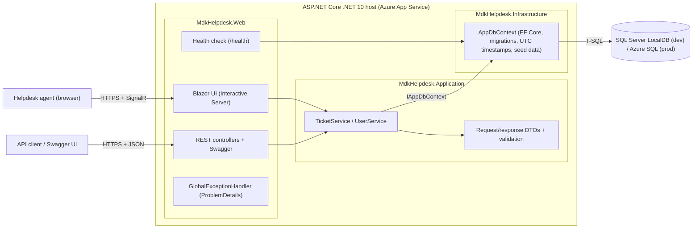
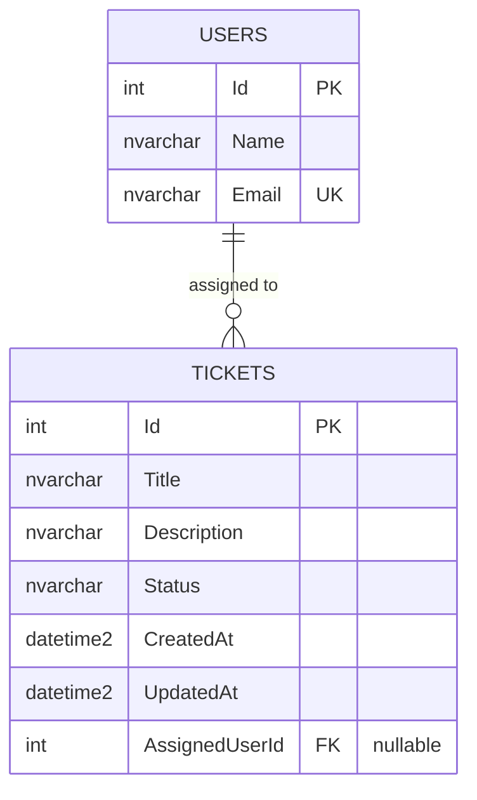
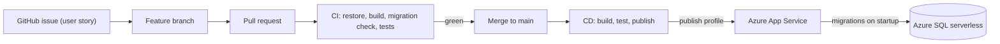
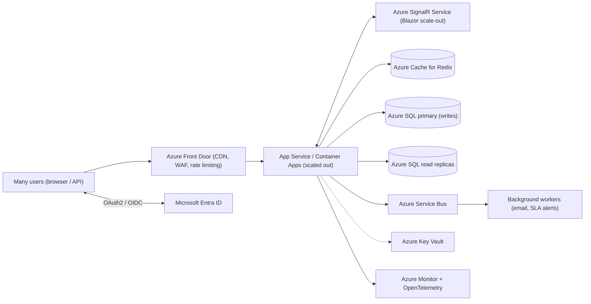

# Technical Design — MDK IT Helpdesk MVP

How the MVP is built and why. The [README](../README.md) gives the overview; this document adds the detail: component structure, data model, API contract, request flow, delivery pipeline, decisions and the path to scale.

The editable diagram source is [architecture.drawio](architecture.drawio) (open it in [diagrams.net](https://app.diagrams.net) or the draw.io VS Code extension). Tab 1 is the current MVP; tab 2 is the scale-up roadmap.

## 1. System architecture

| Project | Responsibility | Depends on |
|---|---|---|
| `MdkHelpdesk.Domain` | `User` and `Ticket` entities, `TicketStatus` enum | nothing |
| `MdkHelpdesk.Application` | Business rules, DTOs, validation, `IAppDbContext` | Domain |
| `MdkHelpdesk.Infrastructure` | `AppDbContext`, table mapping, migrations, seed data | Application, Domain |
| `MdkHelpdesk.Web` | Blazor pages, REST controllers, error handling, DI wiring | all of the above |

The Blazor pages and the REST controllers call the same application services, so every business rule lives in one place and both front ends behave identically.

## 2. Data model

### `Users`

| Column | Type | Constraints |
|---|---|---|
| `Id` | `int` | Primary key, identity |
| `Name` | `nvarchar(100)` | Required |
| `Email` | `nvarchar(200)` | Required, unique index |

### `Tickets`

| Column | Type | Constraints |
|---|---|---|
| `Id` | `int` | Primary key, identity |
| `Title` | `nvarchar(150)` | Required; 3–150 characters on input |
| `Description` | `nvarchar(2000)` | Required |
| `Status` | `nvarchar(20)` | Required; `Open`, `InProgress` or `Closed`, stored as text |
| `CreatedAt` | `datetime2` | Required, UTC, set once on insert |
| `UpdatedAt` | `datetime2` | Required, UTC, set on insert and every update |
| `AssignedUserId` | `int` | Nullable foreign key to `Users.Id`, `ON DELETE SET NULL` |

Seed data (applied by the migrations): 4 users and 4 tickets covering every status, plus an unassigned ticket and a user with no tickets, so each filter state can be demonstrated.

## 3. REST API contract

| Method | Route | Purpose | Responses |
|---|---|---|---|
| `GET` | `/api/tickets?status=&assignedUserId=&unassigned=` | List tickets, filtered by status and by assignee or unassigned only | `200`, `400` |
| `GET` | `/api/tickets/{id}` | Get one ticket | `200`, `404` |
| `POST` | `/api/tickets` | Create a ticket, optionally assigned; always starts as `Open` | `201`, `400` |
| `PUT` | `/api/tickets/{id}` | Update title, description and status (not the assignee) | `200`, `400`, `404` |
| `PATCH` | `/api/tickets/{id}/assign` | Assign to a user, or unassign with `null` | `200`, `400`, `404` |
| `GET` | `/api/users` | List users available for assignment | `200` |
| `GET` | `/health` | App and database health | `200`, `503` |

- Combining `assignedUserId` with `unassigned=true` is rejected with `400`.
- Assigning to a user that doesn't exist is rejected with `400`.
- All errors use RFC 7807 `ProblemDetails`. Validation failures return field-level messages.
- Status values are serialized as strings. The full contract, with schemas, is in Swagger at `/swagger`.

## 4. Request flow: creating a ticket

1. **Model binding and validation.** `TicketsController.Create` receives a `CreateTicketRequest`. Data annotations check the title and description; an invalid payload returns `400` before the controller action runs.
2. **Business rules.** `TicketService.CreateAsync` checks that any `AssignedUserId` refers to an existing user, trims the input and sets the status to `Open` on the server, whatever the client sent.
3. **Persistence.** `AppDbContext.SaveChangesAsync` stamps `CreatedAt` and `UpdatedAt` in UTC, and EF Core issues a parameterized `INSERT`.
4. **Response.** The controller returns `201 Created` with a `Location` header and the new ticket.
5. **Errors.** A broken rule throws `ArgumentException`, which `GlobalExceptionHandler` logs and turns into a `400 ProblemDetails`. Anything unexpected becomes a `500` with no stack trace exposed.

The Blazor pages follow the same path from step 2, calling `ITicketService` directly.

## 5. Cross-cutting concerns

| Concern | Approach |
|---|---|
| Validation | Data annotations on DTOs for field rules; database-dependent rules in the services |
| Error handling | `IExceptionHandler` + `ProblemDetails`, consistent across the API |
| Logging | `ILogger<T>` with structured message templates through the standard .NET logging providers; sending logs to Azure (Application Insights) is on the roadmap |
| Timestamps | Set centrally in `SaveChangesAsync`, always UTC |
| Resilience | `EnableRetryOnFailure` retries transient SQL errors, such as Azure SQL serverless resuming from pause |
| Health | `/health` checks database connectivity via `AddDbContextCheck` |
| Configuration and secrets | Connection string from App Service settings in production; nothing secret in the repo |
| SQL injection | All database access goes through EF Core's parameterized queries |
| Output encoding | Razor encodes rendered values by default |

## 6. Delivery pipeline

- **CI** (`.github/workflows/ci.yml`) runs on every pull request into `main` and every push to `main`. It also fails if the EF Core model has changed without a matching migration.
- **CD** (`.github/workflows/deploy.yml`) runs on every push to `main` (or when run manually), independently of CI. It re-runs the tests, publishes the web project and deploys it to App Service.
- **Schema changes** ship with the code: with `Database__ApplyMigrationsOnStartup=true` set in App Service, the app applies pending migrations when it starts.

## 7. Architecture decision records

| # | Decision | Reason | Trade-off accepted |
|---|---|---|---|
| 1 | Blazor Interactive Server + REST controllers sharing the services | One language end to end, no separate front-end build, and still a documented API for integrations and tests | Each open page holds a server connection (SignalR circuit); fine for an internal team |
| 2 | Layered projects with dependencies pointing inward | Business rules don't depend on UI or database details and can be tested in isolation | Four projects instead of one |
| 3 | `IAppDbContext` instead of a repository layer | `DbSet<T>` already is a repository; another wrapper adds code without value at this size | Services use EF Core query APIs directly |
| 4 | SQL Server everywhere (LocalDB → Azure SQL) | Same SQL dialect and migrations in development and production | Local setup needs LocalDB or Docker rather than a file database |
| 5 | Assignment as its own operation | Edit and assign are separate actions with separate rules and controls | One extra endpoint |
| 6 | Status stored as text | Readable when querying the database directly; an enum in code prevents invalid values | Slightly larger column than an integer |
| 7 | Azure App Service (PaaS) rather than containers or Kubernetes | Managed TLS, scaling and deployment with no orchestration to run | Less control over the runtime environment |
| 8 | Migrations applied on startup | Each deploy keeps the schema in step with the code, with no manual step | With several instances, a dedicated migration step in the pipeline would be safer |

## 8. Scale-up roadmap (beyond the MVP)

What would change if the tool grew from one team to a large organization:

In rough order of need:

1. **Authentication and authorization** with Microsoft Entra ID, and role-based access to the API.
2. **Paging and sorting** on the ticket list, with indexes to match the filters.
3. **Observability**: Application Insights / OpenTelemetry for traces, metrics and alerts.
4. **Optimistic concurrency** (a row version on `Tickets`) so two agents can't silently overwrite each other's edits.
5. **Audit history** of status and assignment changes.
6. **A deployment slot** for staging, with a swap to production, and a dedicated migration step in the pipeline.
7. **Scale-out**: Azure SignalR Service for Blazor circuits, Redis caching, read replicas, and Service Bus for notifications.
